# Sample & Bulk Order Handbook
### CC Production & QMS — Cotton to Customer

This handbook covers **everything** involved in creating and running orders: from opening the
login screen, to creating a Sample Class or Bulk Project, to registering orders under it, to
driving every production stage through QC approval, rejection, defect gating, completion,
promotion to bulk, and reordering.

Every step below has a screenshot taken from the live system, followed by a short explanation of
what you are looking at and exactly what to click.

---

## Contents

| # | Section |
|---|---|
| 1 | [How the system is organised](#1-how-the-system-is-organised) |
| 2 | [Who can do what (roles)](#2-who-can-do-what-roles) |
| 3 | [Logging in](#3-logging-in) |
| 4 | [Step 1 — Create a Sample Class](#4-step-1--create-a-sample-class) |
| 5 | [Step 2 — Create a Sample Order (prototype)](#5-step-2--create-a-sample-order-prototype) |
| 6 | [Step 3 — Run the sample stages](#6-step-3--run-the-sample-stages) |
| 7 | [Step 4 — The PPS QC Check decision](#7-step-4--the-pps-qc-check-decision) |
| 8 | [Step 5 — Rejection, iterations, CA & PA](#8-step-5--rejection-iterations-ca--pa) |
| 9 | [Step 6 — Sample completed → Move to Bulk](#9-step-6--sample-completed--move-to-bulk) |
| 10 | [Step 7 — Create a Bulk Project](#10-step-7--create-a-bulk-project) |
| 11 | [Step 8 — Register Style POs (bulk orders)](#11-step-8--register-style-pos-bulk-orders) |
| 12 | [Step 9 — Run the 15 bulk stages](#12-step-9--run-the-15-bulk-stages) |
| 13 | [Step 10 — Conditional approval & defect gating](#13-step-10--conditional-approval--defect-gating) |
| 14 | [Step 11 — Inspection stages, completion & Reorder](#14-step-11--inspection-stages-completion--reorder) |
| 15 | [Everyday order actions](#15-everyday-order-actions) |
| 16 | [Supporting screens](#16-supporting-screens) |
| 17 | [Error messages explained](#17-error-messages-explained) |
| 18 | [Quick reference](#18-quick-reference) |

---

## 1. How the system is organised

Everything in the system sits in four levels. You always work top-down.

| Level | What it is | Where you manage it |
|---|---|---|
| **1. Vendor** | The factory that will make the goods. Holds floors, lines and a sampling department. | **Vendors** |
| **2. Project class** | The folder that groups orders for one customer programme. Called a **Sample Class** on the sampling side and a **Bulk Project** on the bulk side. | **Sampling Projects** / **Bulk Projects** |
| **3. Order** | One actual job — a prototype, or a PO for a quantity of a style. | Inside the class, via **View Orders** / **View Batch Items** |
| **4. Stages** | The sequential production steps of that order, each with its own target date, buffer, comments, attachments and approvals. | Inside the order detail page |

> **You cannot create an order without a class, and you cannot create a class without a vendor.**
> If the vendor dropdown is empty, the vendor has to be created (or assigned to you) first.

### The two tracks

The system runs two separate pipelines. They look similar but behave differently.

| | **Sampling track** | **Bulk track** |
|---|---|---|
| Menu | Sampling Projects | Bulk Projects |
| Container | Sample Class | Bulk Project |
| Create button | **Initiate Prototype** | **Register Style PO** |
| Orders per submit | One order | Many orders (batches) at once |
| Default stages | 10 | 15 |
| Where goods are placed | Vendor **sampling department** (no floor/line needed) | Vendor **floors and lines** |
| Stage that decides quality | **PPS QC Check** (3 options) | **PP Sample Development** (3 options) + 3 inspection stages (Accept/Reject) |
| Rejection can restart from | **Any earlier stage** | **Only the same stage** (that stage repeats) |
| When finished | Can be **promoted to Bulk** | Can be **reordered** |

---

## 2. Who can do what (roles)

The menu and the buttons you see change with your role. If a button in this handbook is missing
on your screen, check this table first.

| Action | Super Admin | Admin | Manager | QC Officer | Viewer |
|---|---|---|---|---|---|
| See all company data | Yes | Yes | Only own vendors | Only own vendors | Yes (read-only) |
| Create Sample Class / Bulk Project | Yes | Yes | Yes | No | No |
| **Edit / delete** a class card | Yes | No | Yes | No | No |
| Deactivate a class | Yes | Yes | Yes | Yes | No |
| Create orders | Yes | Yes | Yes | No | No |
| Edit an order | Yes | Yes | Yes | No | No |
| Update stages, approve, reject, clear defects | Yes | Yes | Yes | Yes | No |
| Cancel an order | Yes | Yes | Yes | Yes | No |
| Promote to bulk / Reorder | Yes | Yes | Yes | No | No |
| Move an order to another class | Yes | Yes | Yes | No | No |
| Users menu | Yes | Yes | No | No | No |

Two rules that surprise people:

- **Super Admins and Managers see the pencil and bin icons on a Sample Class or Bulk Project card.** Other
  roles can still view or work inside them.
- **Managers and QC officers only see vendors they are the assigned manager for.** If an order or
  vendor is "missing", it usually belongs to another manager. Ask an admin to assign the vendor to you.
- **Viewers see everything but can change nothing.** A blue *Viewer Mode* banner appears at the top of
  order pages and all action buttons are hidden.

---

## 3. Logging in

Open the system in your browser. You land on the sign-in screen.

The left panel is only branding. Everything you need is the white card on the right.

**Steps**

1. Type your work email in **Email Address**.
2. Type your password in **Password**. The eye icon reveals it if you need to check a typo.
3. Tick **Remember me** if this is your own device.
4. Click **Sign In**.

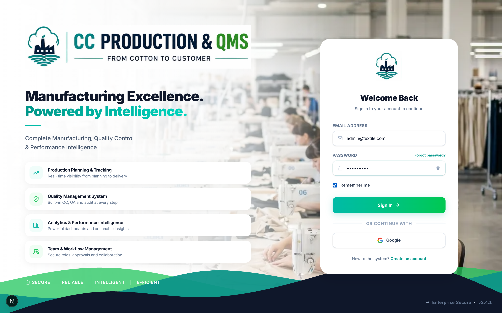

**Other options on this screen**

| Link / button | What it does |
|---|---|
| **Forgot password?** | Sends a reset *request* to the admin queue. An administrator must approve it before you get a reset link — it is not an automatic email. |
| **Google** | Signs in with a linked Google account, if your installation has it configured. |
| **Create an account** | Public sign-up. New accounts are created as **Viewer** (read-only). An admin must promote you to Manager or QC Officer before you can create anything. |

If the credentials are wrong you get a red banner reading *Invalid email or password.* Nothing is
locked — just retry.

### After sign-in: the Dashboard

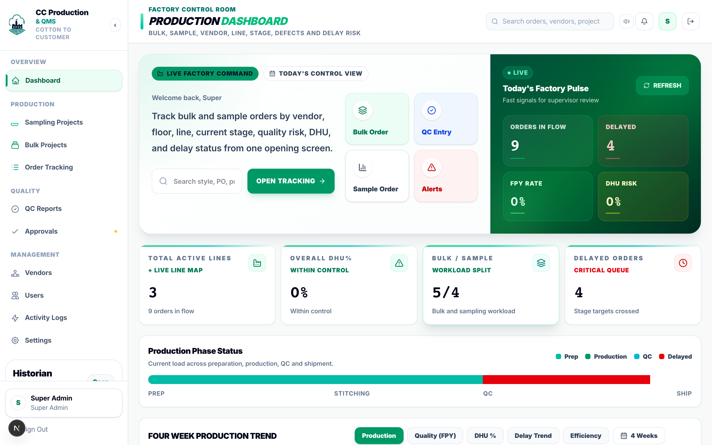

You arrive at the **Production Dashboard**. Read it left to right:

- **Left sidebar** — your navigation, grouped into Overview, Production, Quality and Management.
  The items you see depend on your role. The **‹** button collapses it to icons.
- **Today's Factory Pulse** (green panel) — live counts of orders in flow, delayed orders, FPY rate
  and DHU risk.
- **Quick tiles** — *Bulk Order*, *QC Entry*, *Sample Order* and *Alerts* jump straight into those areas.
- **Historian** (bottom of the sidebar) — the last few factory events; visible to Super Admin, Admin
  and Manager only.
- **Top-right icons** — global search, notifications, your profile initial, and sign-out.

For order work you will use only two sidebar links: **Sampling Projects** and **Bulk Projects**.

---

## 4. Step 1 — Create a Sample Class

A **Sample Class** is the folder that holds all prototype orders for one customer style programme.
Create it before any sample order.

Click **Sampling Projects** in the sidebar.

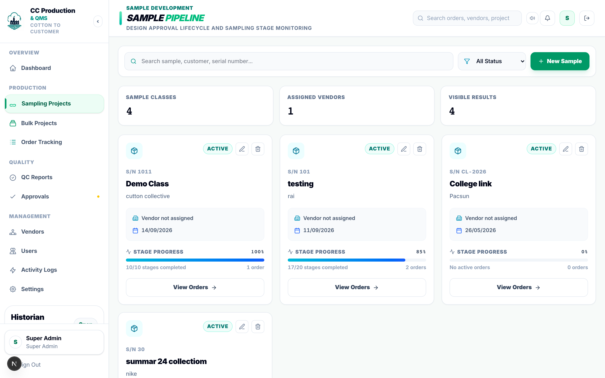

What is on this screen:

- **Search box** — searches sample name, customer and serial number.
- **All Status** filter — narrows by class status (active, completed, inactive).
- **New Sample** button — creates a class (hidden for Viewers).
- **Three summary cards** — total classes, how many have a vendor assigned, and how many match your
  current filters.
- **One card per class** showing serial number, name, customer, vendor, created date and a
  **Stage Progress** bar. The bar is the average completion of all stages of all active orders in
  that class, so a brand-new class reads 0%.
- **View Orders** at the bottom of each card opens the orders inside that class.

Click **New Sample**. The create dialog opens empty:

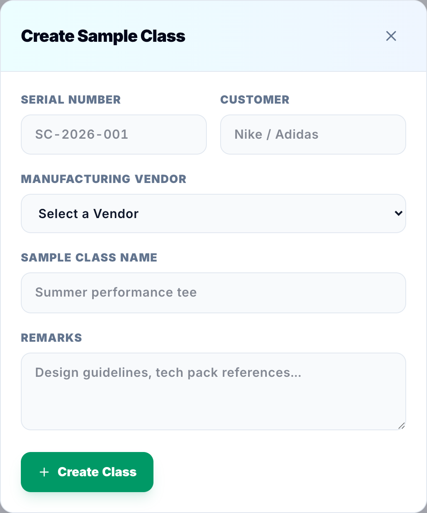

Fill it in:

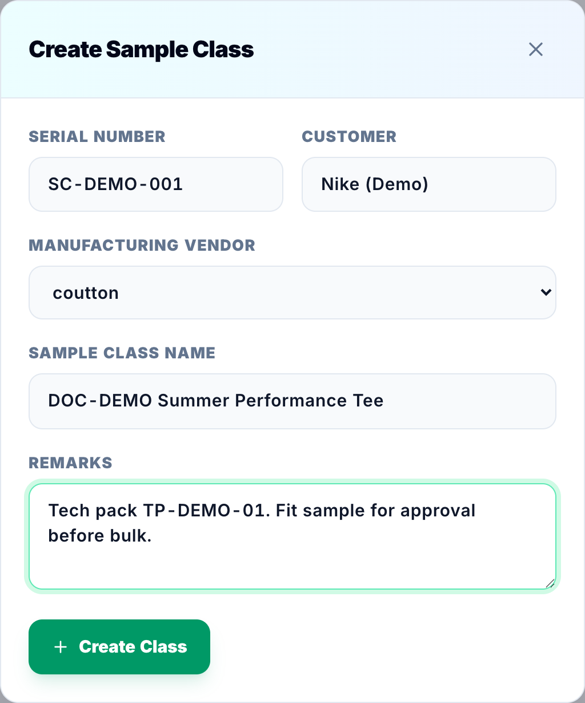

| Field | Required | What to enter |
|---|---|---|
| **Serial Number** | Yes | Your internal reference for the class, e.g. `SC-2026-001`. Searchable. |
| **Customer** | Yes | The buyer, e.g. `Nike`. Searchable. |
| **Manufacturing Vendor** | Yes | The factory. Only vendors you are allowed to use appear here. |
| **Sample Class Name** | Yes | A human name for the programme, e.g. `Summer performance tee`. Searchable. |
| **Remarks** | No | Free notes — tech pack references, design guidance, anything the team should see. |

Click **Create Class**. A green *Mission Successful* confirmation appears and closes itself after a
couple of seconds.

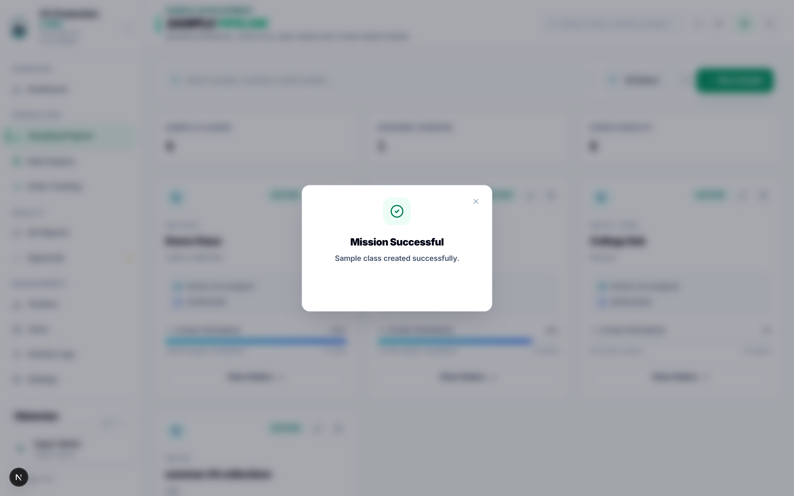

The new class now appears as a card in the grid:

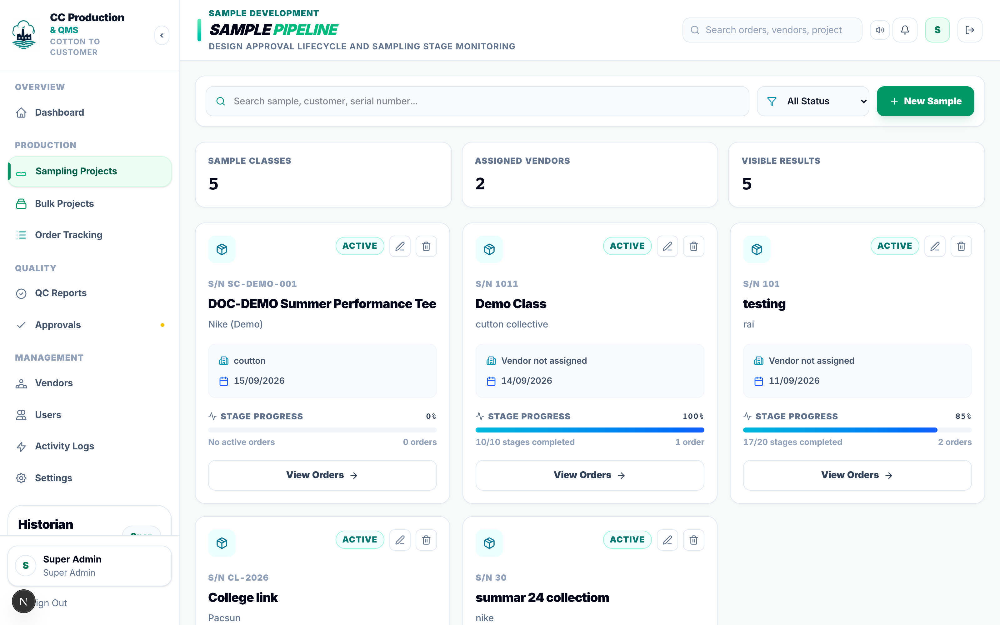

> **Editing / deleting a class later:** **Super Admins and Managers** see the pencil (edit) and bin (deactivate) icons on the card. Deactivating a class sets it to *inactive* **and cancels every active order inside it** — the history stays readable, but the orders stop.
> 
> **Export CSV:** Click the **Export CSV** button in the top toolbar to instantly download a comprehensive CSV spreadsheet with product info, customer, vendor, stage progress, and latest stage update details.

---

## 5. Step 2 — Create a Sample Order (prototype)

Open the class you just created with **View Orders**. This is the order list for that class — empty
for a new class.

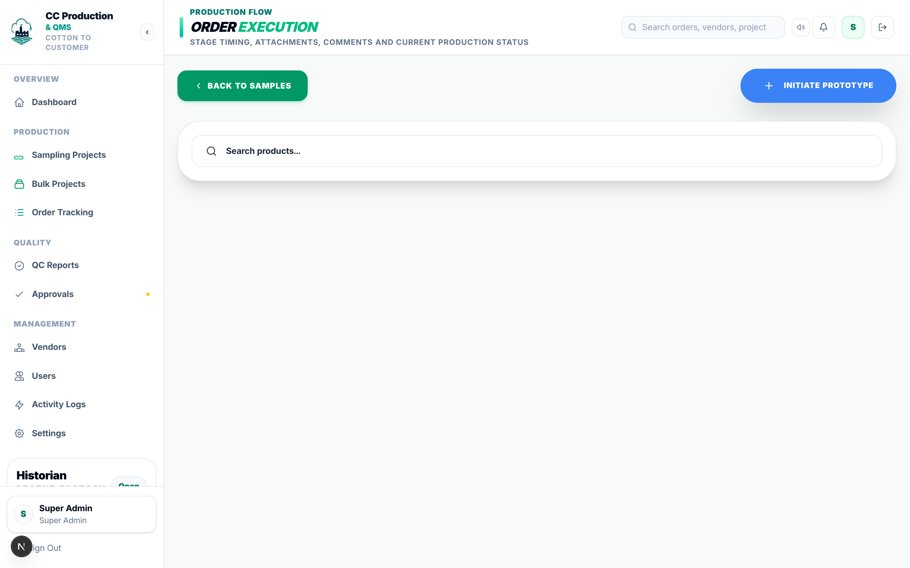

- **Back to Samples** returns to the class grid.
- **Initiate Prototype** creates a sample order *inside this class*.
- **Search products…** filters the cards by PO, style or product name.

Click **Initiate Prototype**.

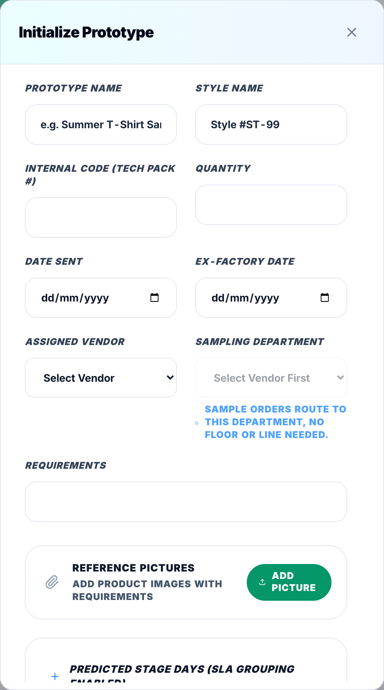

### 5.1 Product and schedule fields

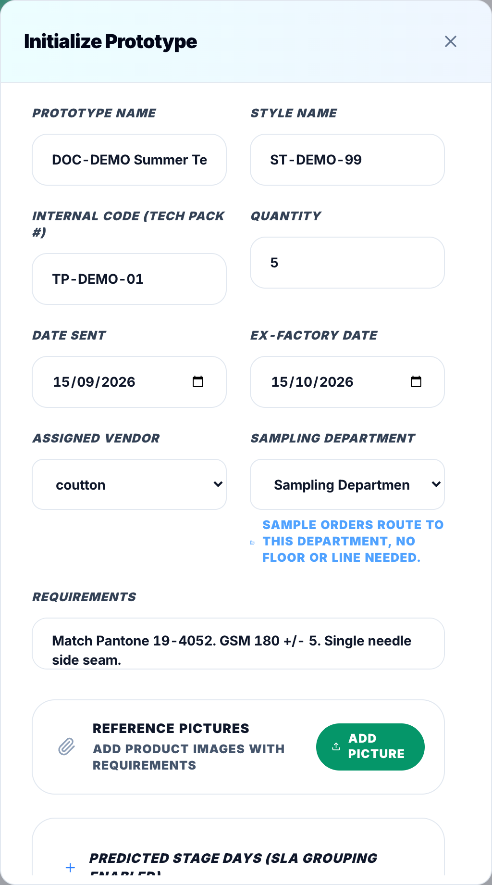

| Field | Required | Notes |
|---|---|---|
| **Prototype Name** | Yes | The product, e.g. `Summer T-Shirt Sample`. This is the title shown on the order card and order page for sampling. |
| **Style Name** | Yes | Style reference, e.g. `Style #ST-99`. |
| **Internal Code (Tech Pack #)** | No | Your tech pack or internal code. |
| **Quantity** | Yes | Number of sample pieces. |
| **Date Sent** | No | The day the job starts. **This is the date all stage target dates are calculated from.** Leave it blank and the system counts from today. |
| **Ex-Factory Date** | No | The promised delivery date. Once this date passes and the order is not complete, the order is flagged **delayed** and every unfinished stage turns red. |
| **Assigned Vendor** | Yes | The factory making the sample. Changing it resets the department choice. |
| **Sampling Department** | Yes | Pick the vendor's sampling department. Sample orders go to a department, **not** to a floor or line. If the vendor has none, the system creates a default "Sampling Department" automatically. |
| **Requirements** | No | Written specification — Pantone, GSM, stitching notes, tolerances. Visible to everyone on the order. |

### 5.2 Reference pictures

Click **Add Picture** in the *Reference Pictures* box and choose one or more **image** files
(JPG, PNG, WebP — PDFs are rejected here).

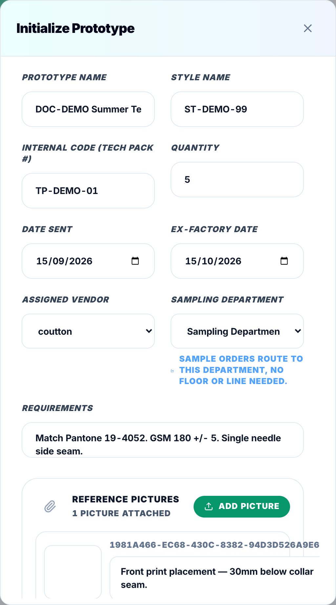

Each picture gets its own **requirement** text box. Use it to say what the picture proves —
"front print placement 30mm below collar seam". The first picture also becomes the order's main
reference image. The **×** removes a picture.

### 5.3 Predicted Stage Days — how the schedule is built

This panel is the most important part of the form. It decides **which stages exist** and **when each
one is due**.

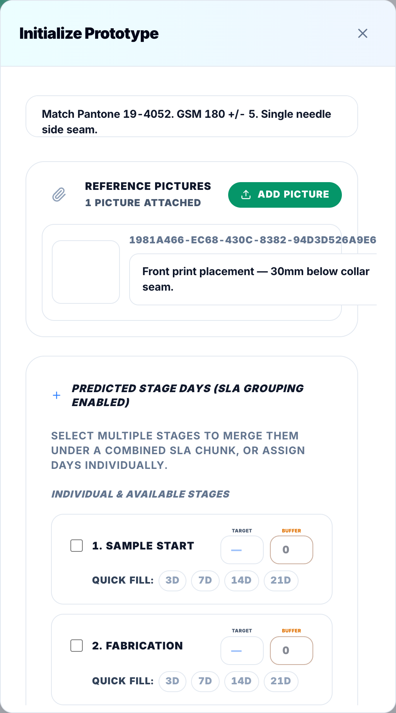

The ten sampling stages are listed in order. Each row has:

- a **checkbox** (used only for merging, see below),
- **Target** — how many days that stage should take,
- **Buffer** — extra contingency days,
- **Quick fill** buttons (3d / 7d / 14d / 21d) as shortcuts.

Two rules you must know:

1. **A stage with Target = 0 is not created at all.** Only stages with days (or stages inside a merged
   chunk) become part of the order. If you leave everything at 0 the form refuses to submit with
   *"Add predicted days for at least one sample stage."*
2. **Target days are cumulative.** The system starts at *Date Sent* and adds each stage's target days
   in sequence, so stage 1's target date is Date Sent + its days, stage 2's is that date plus its own
   days, and so on. **Buffer days are recorded separately and do not move the target dates** — they
   are visible contingency, shown as `+2d buf`, not extra schedule.

Fill in days for every stage you want:

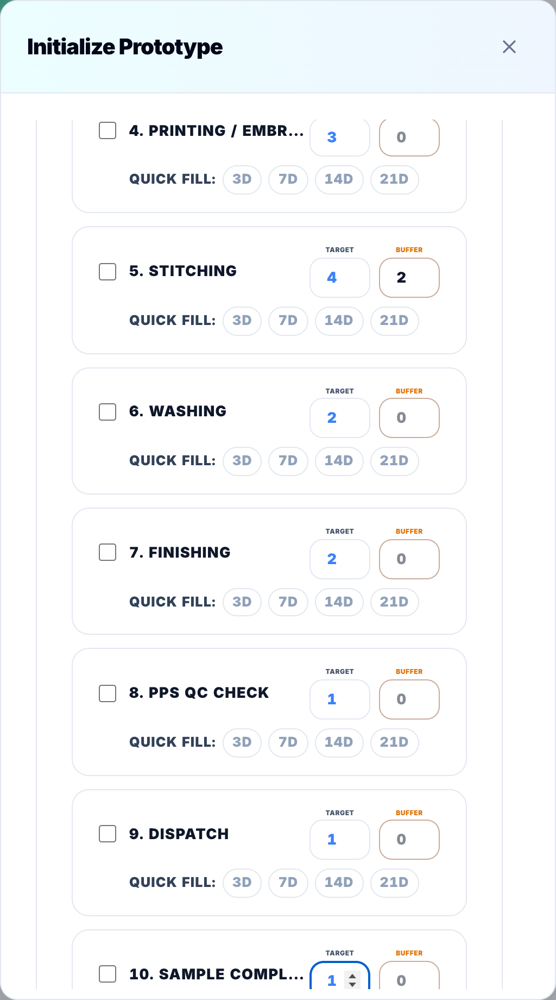

**Merging stages into one SLA chunk** (optional): tick two or more stages, click
**Merge Selected (n)**, enter the total days for the group and confirm. The group then shares one
deadline instead of each stage having its own, and the rows show *SLA Managed by Parent Chunk*.
**Unmerge** dissolves it. This is shown in detail in the bulk section
([§11.3](#113-stage-days-and-sla-chunks)) — it works identically on both tracks.

> **⚠️ Ex-Factory Date Guard:** The cumulative duration of all stages (including individual days and merged SLA chunks) cannot exceed the order's Ex-Factory Date. If assigned days exceed the time available before the Ex-Factory date, a red alert notification triggers:
> *"⚠️ You exceed X day(s) to Ex-Factory date!"*
> The system locks the submit button with `Exceeds Ex-Factory Date by Xd` until stage days or the Ex-Factory date are adjusted.

### 5.4 Submit

Click **Launch Track** at the bottom. The sample order is created and you are taken straight to its
detail page.

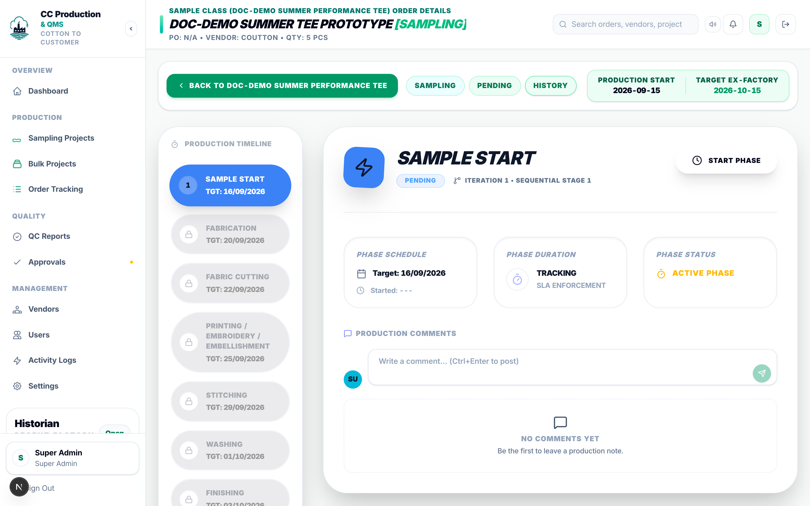

Read this page as three columns:

- **Top bar** — back button, the track (`sampling`), the order status (`pending`), a **History**
  button, and on the right the **Production Start** and **Target Ex-Factory** dates.
- **Production Timeline** (left) — every stage as a pill, numbered, with its target date.
  Stage 1 is open and selected; every later stage shows a **padlock**.
- **Stage panel** (right) — the selected stage, its schedule, status, and the action buttons.

---

## 6. Step 3 — Run the sample stages

Stages run **strictly in order**. You cannot touch stage 3 until stage 2 is completed. Each stage
moves through three states: **pending → in_progress → completed**.

### 6.1 Start a stage

Select the stage in the timeline (only unlocked stages can be selected) and click **Start Phase**.
A confirmation appears:

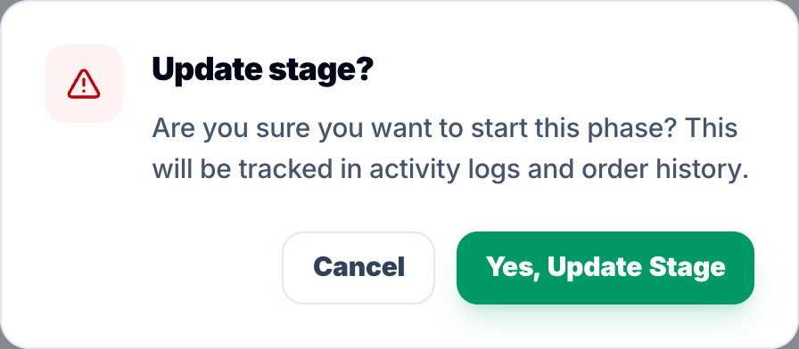

Click **Yes, Update Stage**. Every stage action is deliberately confirmed like this, because each one
is written to activity logs and order history.

The stage is now **in_progress**: its start timestamp is recorded and the button changes to
**Confirm Completion**.

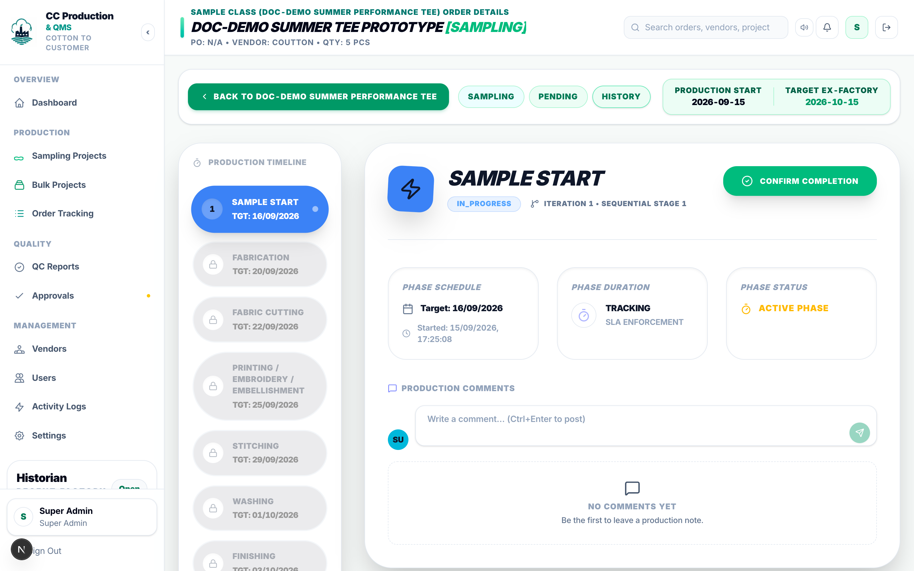

### 6.2 Log what happened — production comments

Every stage has its own **Production Comments** thread. Use it for the running record: what was
received, what went wrong, who was told.

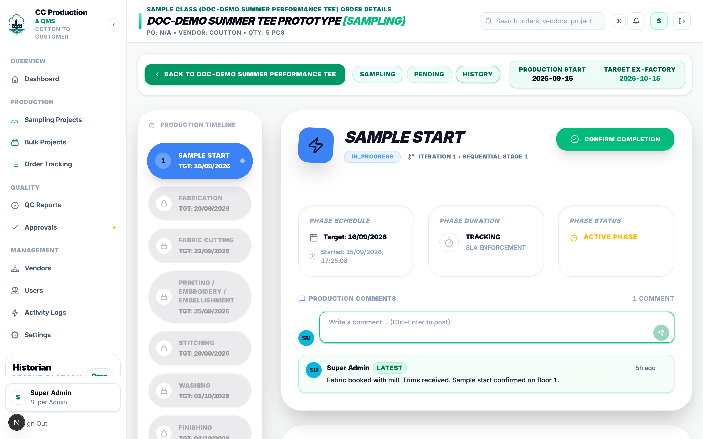

Type in the box and press **Ctrl+Enter** (or click the send arrow). Comments are per stage, stamped
with your name and time. They are the cheapest way to make a job auditable — use them generously.

### 6.3 Complete a stage

Click **Confirm Completion** and confirm. The completion date is stamped, the pill turns green with a
tick, and the system **automatically selects the next stage** for you.

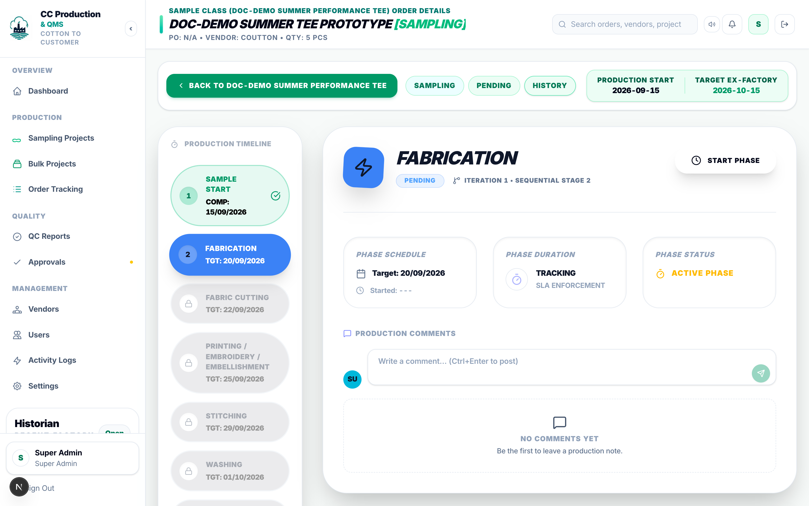

Work down the timeline this way. As stages complete, the timeline fills with green:

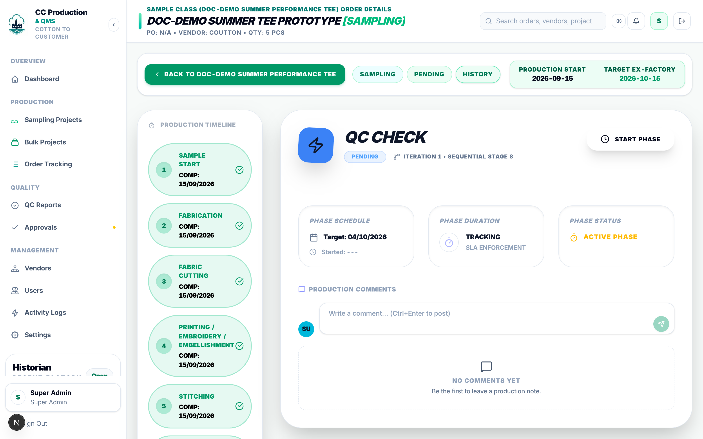

### 6.4 Reading the timeline colours

| Appearance | Meaning |
|---|---|
| **Grey with a padlock** | Locked — an earlier stage is not complete yet. Cannot be selected. |
| **Blue / green filled (selected)** | The stage you are currently looking at. |
| **Green with a tick** | Completed. Shows `COMP: <date>`. |
| **Red with a warning icon** | Past its target date and not complete, or the order's ex-factory date has passed. |
| **Amber with a padlock + GATED** | Blocked by an unresolved conditional defect (bulk only — see [§13](#13-step-10--conditional-approval--defect-gating)). |
| `+2d buf` | That stage has buffer days recorded on top of its target. |

If you select a stage whose predecessor is unfinished, the panel shows
*"Stage Locked: Previous phase must be marked as COMPLETED first."* — that is expected, not an error.

Other things on the stage panel:

- **Phase Schedule** — target date, start timestamp, and buffer if any.
- **Phase Status** — Active Phase or Completed.
- **Iteration n • Sequential Stage n** — which rework round you are in and the stage's position.
- **Phase Documents** (bottom of the page) — **Add Phase Data** uploads a PDF or image against the
  whole order (test reports, measurement sheets). Only PDF, JPG, PNG and WebP are accepted.

---

## 7. Step 4 — The PPS QC Check decision

Stage 8 of the sampling flow, **PPS QC Check**, is the quality gate. It does not have a plain
"complete" button. Start the stage as usual and you get a **QC Decision** panel with three choices:

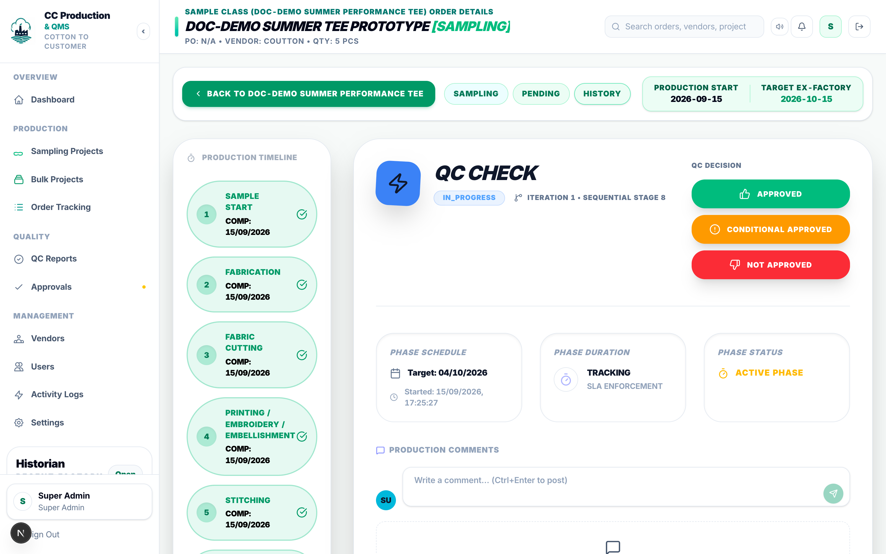

| Decision | Effect |
|---|---|
| **Approved** (green) | Stage is completed and the order advances normally. |
| **Conditional Approved** (amber) | Stage is completed **but** a condition is recorded against it. On the sampling track this is a note; on the bulk track it also **locks** a downstream stage. |
| **Not Approved** (red) | Stage is rejected. The order starts a **new iteration** and production repeats from a stage you choose. |

### 7.1 Approved

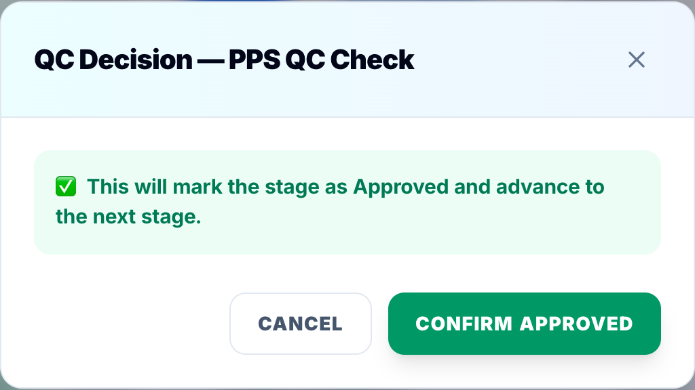

Nothing to fill in. The dialog tells you exactly what will happen. Click
**Confirm approved**.

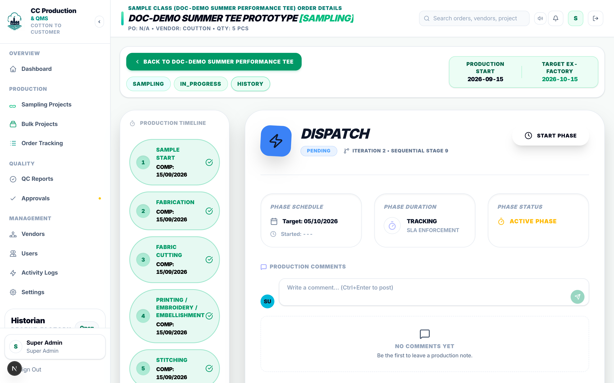

### 7.2 Conditional Approved

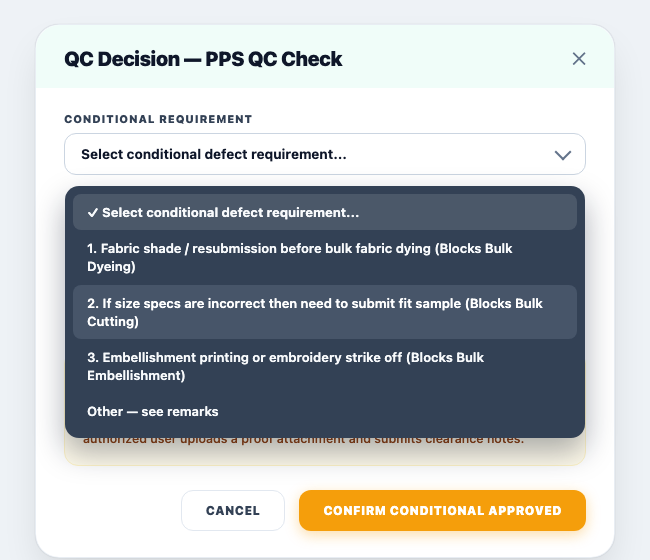

You must pick a **Conditional Requirement** from the list:

| Option | What it gates (bulk track) |
|---|---|
| Fabric shade / resubmission before bulk fabric dying | Blocks the **dyeing** stages |
| If size specs are incorrect then need to submit fit sample | Blocks **bulk fabric cutting** |
| Embellishment printing or embroidery strike off | Blocks **printing / embroidery / embellishment** |
| Other — see remarks | Recorded as a custom condition, no automatic block |

The stage completes and production continues, but the condition stays attached to the order until
someone clears it with proof. See [§13](#13-step-10--conditional-approval--defect-gating).

### 7.3 Not Approved

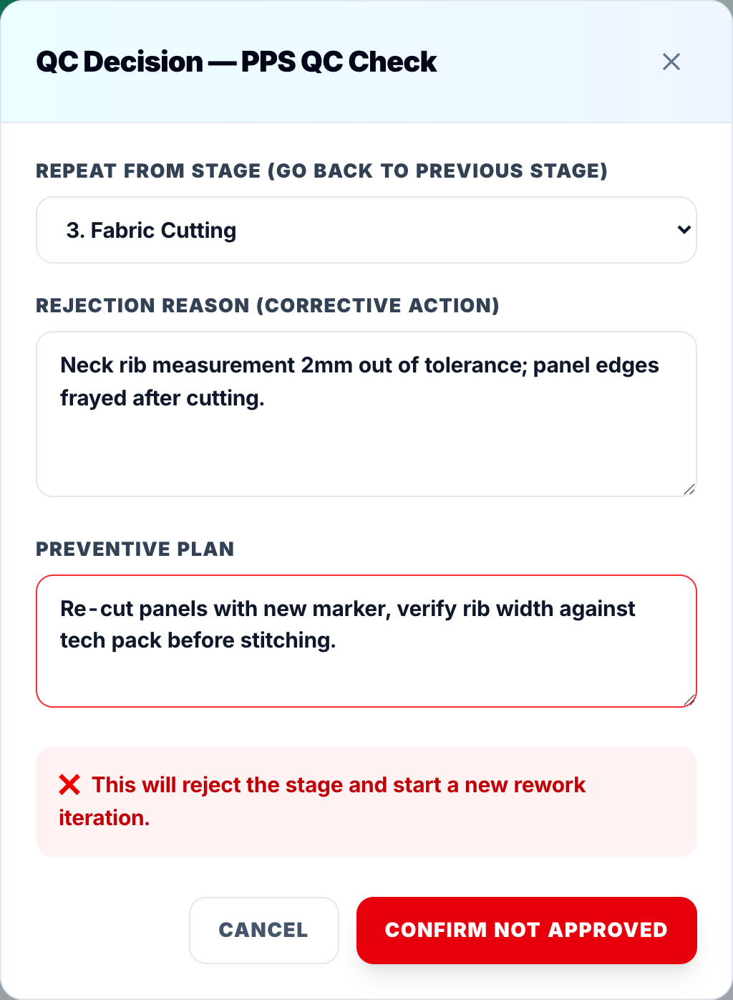

Three inputs:

| Field | Required | Notes |
|---|---|---|
| **Repeat From Stage** | Yes | On the sampling track you may choose **any stage at or before** QC Check — pick the stage where the fault was actually introduced. On the bulk track a stage can only repeat itself. |
| **Rejection Reason (Corrective Action)** | Yes | What is wrong. This becomes the **CA** record. Rejection is refused without it. |
| **Preventive Plan** | No (but expected) | How you will stop it recurring. This becomes the **PA** record. |

Click **Confirm not approved**.

---

## 8. Step 5 — Rejection, iterations, CA & PA

When a stage is rejected, the system does four things at once:

1. Increases the order's **iteration** counter (Iteration 1 → 2).
2. Resets the chosen repeat-from stage **and everything after it** back to *pending*, clearing their
   start and completion dates.
3. Writes the reason and plan into the permanent rejection log.
4. Puts the order back to *in_progress* and re-points it at the repeat-from stage.

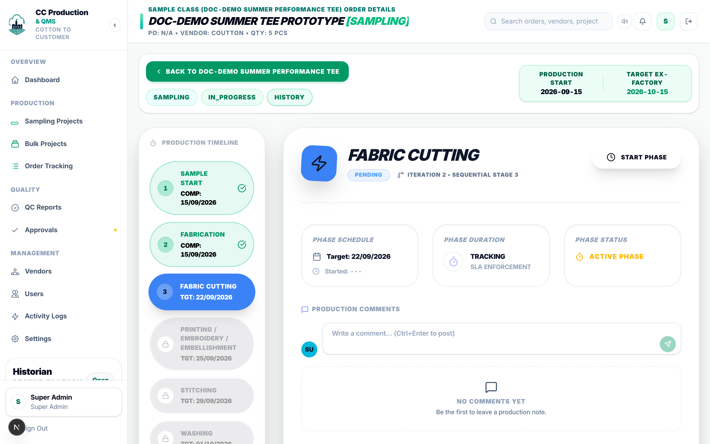

Scroll down the stage panel to find the **QC Rejection Log**:

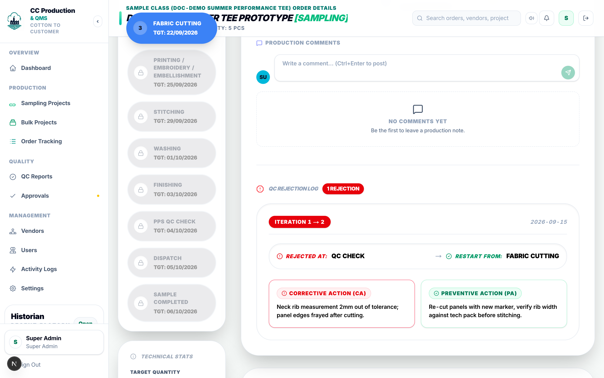

Each entry records the iteration jump, the date, **Rejected At**, **Restart From**, and the two
cards every audit asks for:

- **Corrective Action (CA)** — red card, the defect found.
- **Preventive Action (PA)** — green card, the fix that prevents recurrence.

The log is append-only. It is never overwritten by later iterations, so a style rejected three times
shows all three rounds. This is your CA/PA evidence — write it properly the first time.

> **Rejection is not available on every stage.** On the sampling track only **PPS QC Check** can
> raise a rejection. On the bulk track only **PP Sample Development**, **Small Vet Dying**,
> **Full Flag Dying Production** and **Final Random Inspection** can. Elsewhere you will see only a
> completion button, and the API refuses with *"Rejection is only permitted on designated
> inspection/approval stages."*

After a rejection, re-run the repeated stages exactly as before: start, comment, complete. When you
reach QC Check again you get the same three choices — approve it this time and carry on.

---

## 9. Step 6 — Sample completed → Move to Bulk

When **every** stage is completed, the system automatically sets the whole order to **completed**.
You do not mark the order complete yourself.

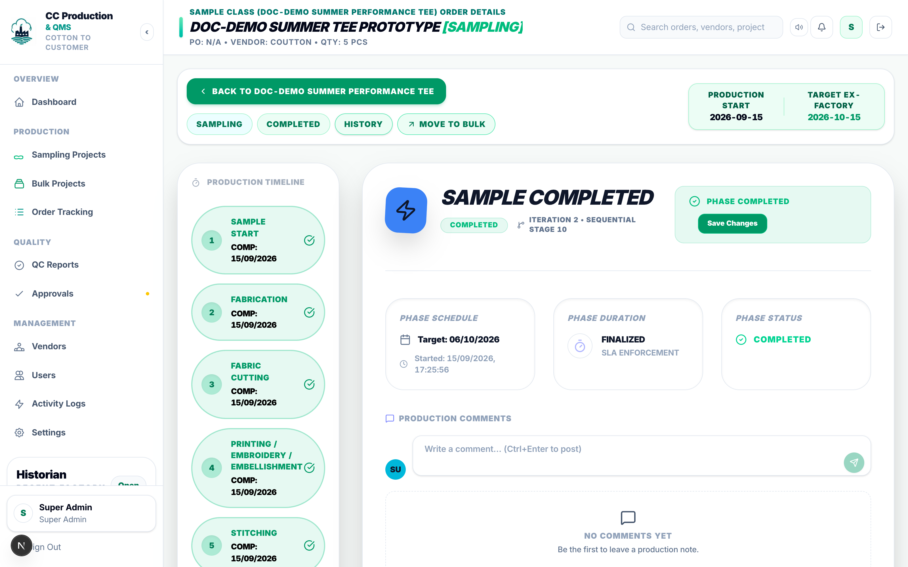

Note what changed in the top bar: the status chip reads **COMPLETED** and a new
**↗ MOVE TO BULK** button has appeared. It only exists on a *sampling* order that is *completed*.

### 9.1 Promoting the sample to a bulk order

Click **Move to Bulk**. A five-part form opens, pre-filled from the sample:

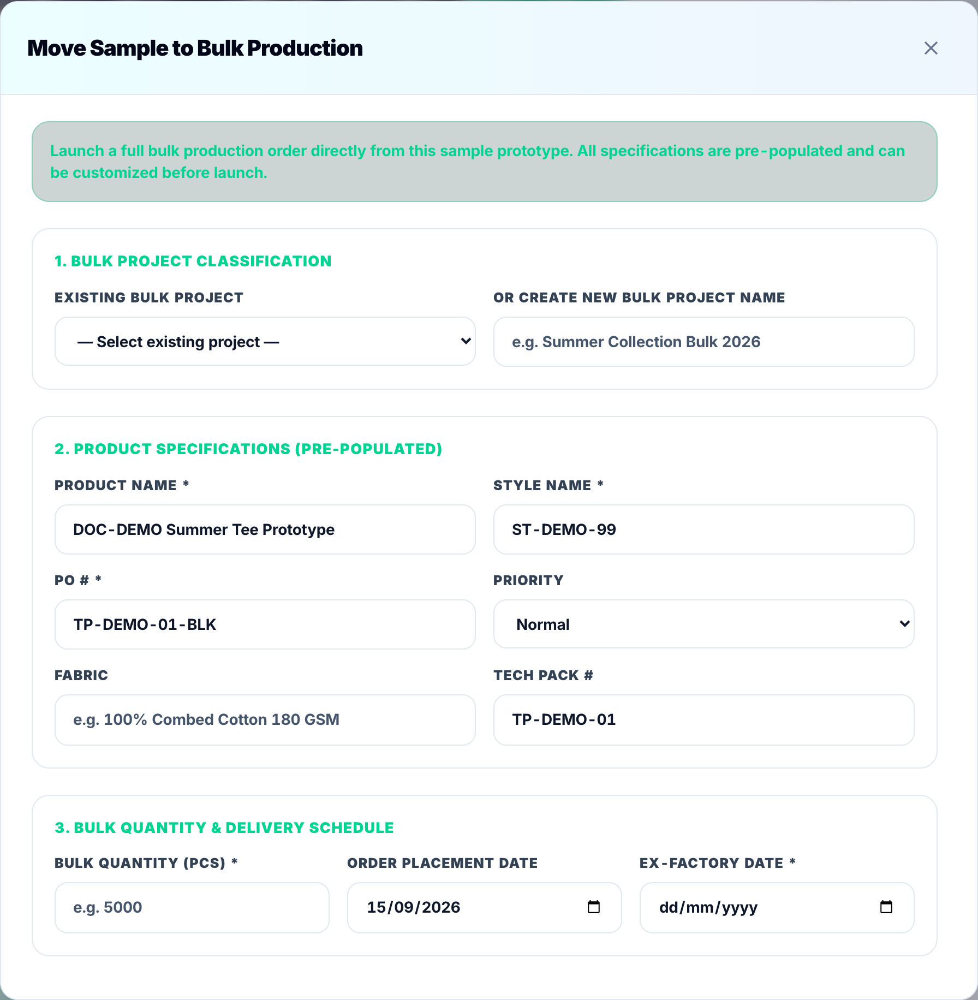

**1. Bulk Project Classification** — either choose an **Existing Bulk Project** from the dropdown,
*or* type a name in **OR Create New Bulk Project Name** and the project is created for you. One of
the two is required.

**2. Product Specifications** — Product Name, Style Name, PO #, Priority, Fabric, Tech Pack #.
Pre-filled from the sample where available.

> **Check the PO #.** It is required. If the sample had its own PO the box reads `<sample PO>-BLK`;
> if it did not, the system suggests one from the tech pack or style name instead. Overwrite the
> suggestion with the real purchase order number before launching.

**3. Bulk Quantity & Delivery Schedule** — **Bulk Quantity** and **Ex-Factory Date** are both
required. Order Placement Date defaults to today and drives the new stage schedule.

**4. Assigned Vendor & Floor Lines** — pick the vendor, then tick floors and lines. A floor ticked
with **no lines** selected means *the whole floor*.

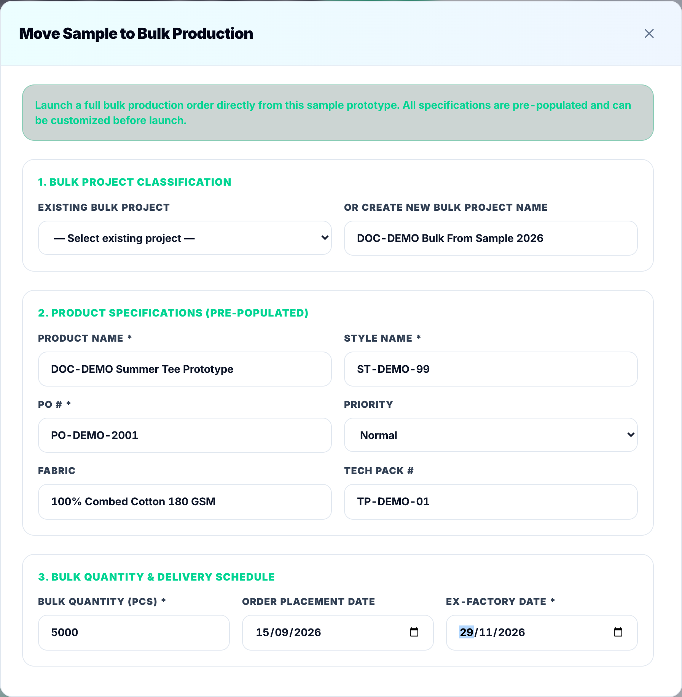

**5. Requirements, reference pictures and the bulk SLA** — the sample's reference pictures are
carried over. Below them the full **15-stage bulk pipeline** is laid out with sensible default days
that you can adjust, merge into chunks, or give buffer to.

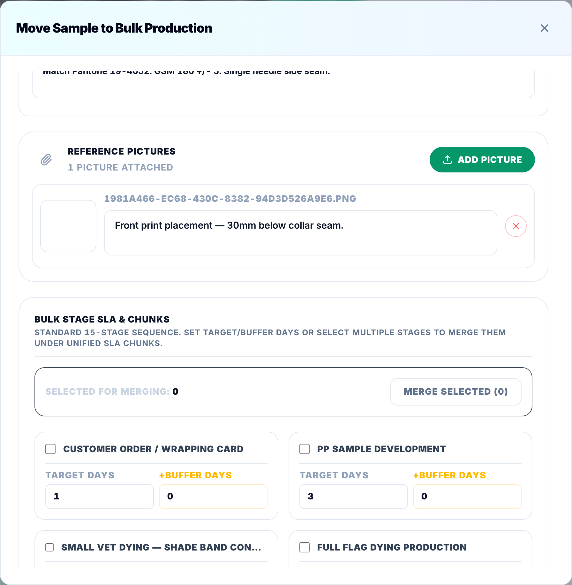

Click **Launch Bulk Production Order →**. A brand-new bulk order is created, linked back to the
sample it came from, and you are taken to it:

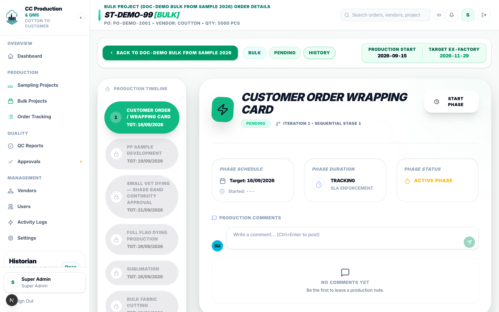

The original sample order is untouched and stays completed. The bulk order starts at stage 1 with
all 15 stages pending.

> Only a **completed sampling** order can be promoted. Trying earlier gives
> *"Only completed sample orders can be promoted to bulk."*

---

## 10. Step 7 — Create a Bulk Project

A **Bulk Project** is the bulk-side equivalent of a Sample Class: the folder that holds the POs for
one production programme.

Click **Bulk Projects** in the sidebar.

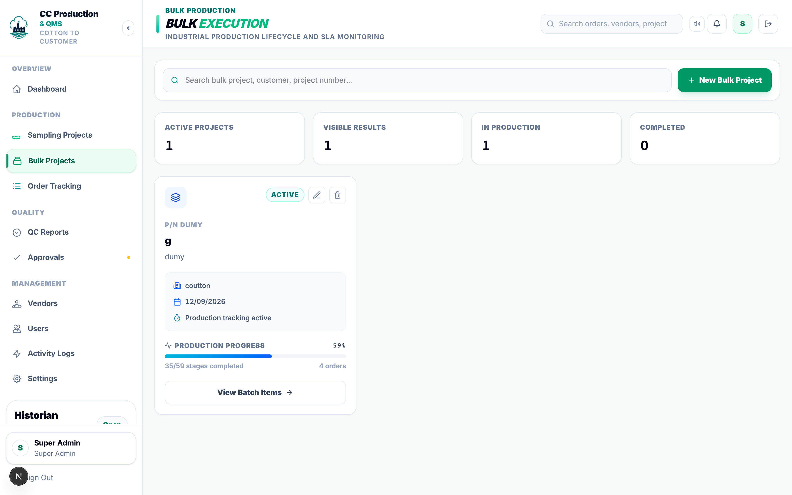

Four summary cards sit above the grid: **Active Projects**, **Visible Results**, **In Production**
and **Completed**. Each project card shows the project number, name, customer, the vendors actually
used by its orders, a **Production Progress** bar, and **View Batch Items** to open its orders.

Click **New Bulk Project**:

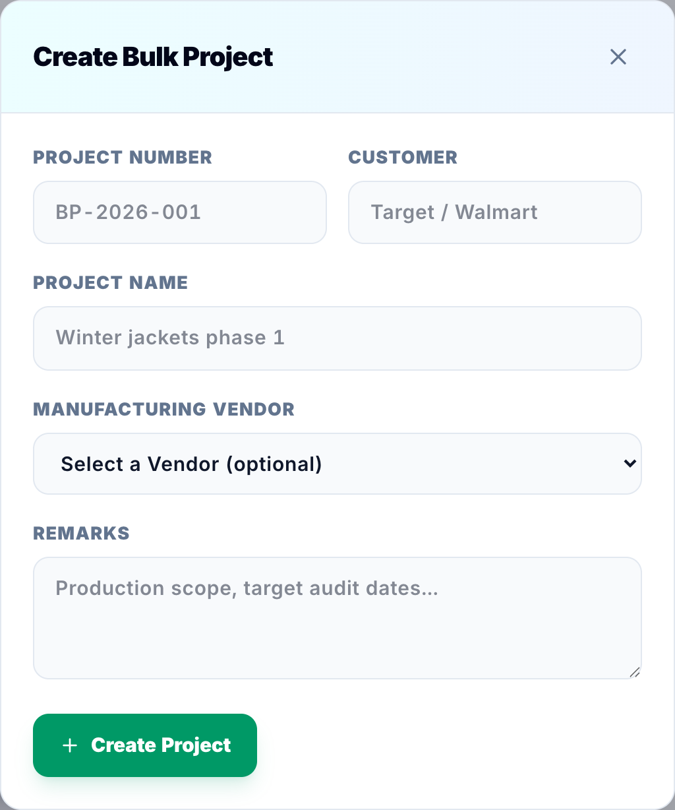

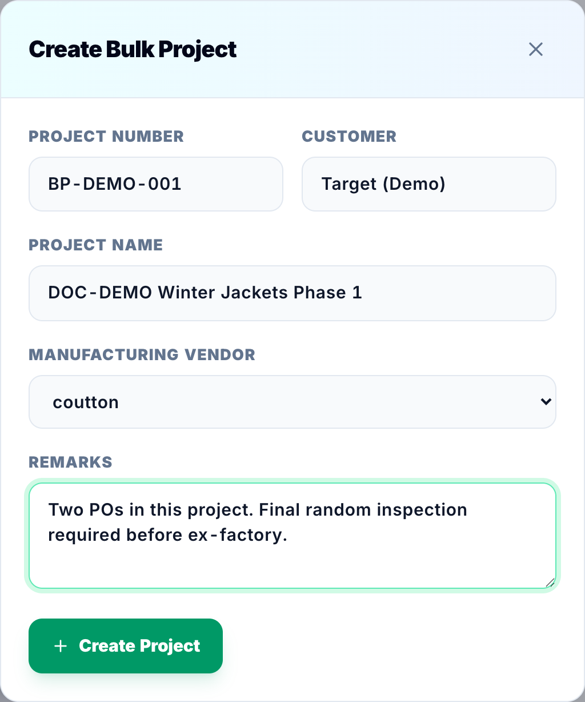

| Field | Required | Notes |
|---|---|---|
| **Project Number** | Yes | e.g. `BP-2026-001`. Searchable. |
| **Customer** | Yes | e.g. `Target`. Searchable. |
| **Project Name** | Yes | e.g. `Winter jackets phase 1`. |
| **Manufacturing Vendor** | No | Optional here — each order picks its own vendor, so one project can span several factories. |
| **Remarks** | No | Scope, target audit dates, notes. |

Click **Create Project**. The card appears in the grid:

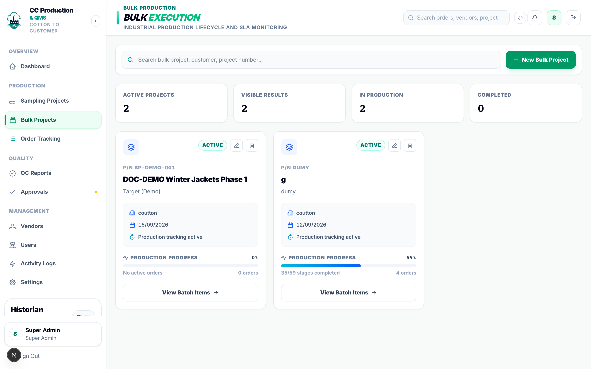

> As with sample classes, **Super Admins and Managers can edit or delete a project card**, and deactivating a project cancels every active order inside it.
> 
> **Export CSV:** Click the **Export CSV** button in the top toolbar to download an Excel-compatible report of all bulk projects with customer, vendors, stage completion progress, and latest stage update details.

---

## 11. Step 8 — Register Style POs (bulk orders)

Open the project with **View Batch Items**:

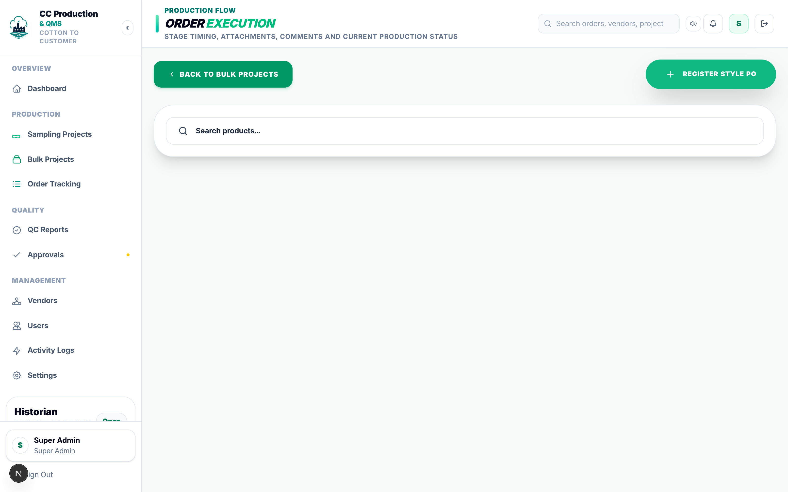

Click **Register Style PO**. The dialog is titled **Add Products**, and this is the key difference
from sampling: **you can register several POs in one submit**. Each one is a *Product Batch*.

### 11.1 Per-batch fields

| Field | Required | Notes |
|---|---|---|
| **Product Name** | Yes | The product for this batch. |
| **PO #** | Yes | The purchase order number. Shown on the card as `PO: …`. |
| **Style Name** | Yes | The style reference, e.g. `WJ-DEMO-M-2026`. This becomes the order's title on the card and the order page, and it is required later by **Reorder** — so fill it properly now. |
| **Quantity** | Yes | Pieces for this PO. |
| **Ex-Factory Date** | Yes | Delivery date for this PO. Required on bulk (unlike sampling). |
| **Vendor** | Yes | The factory for this batch. Changing it clears the floor selection. |
| **Floors & Lines** | No | Where the work will run. |
| **Reference Pictures** | No | Per-batch images, each with its own requirement note. |

**Floors & Lines** loads once a vendor is chosen:

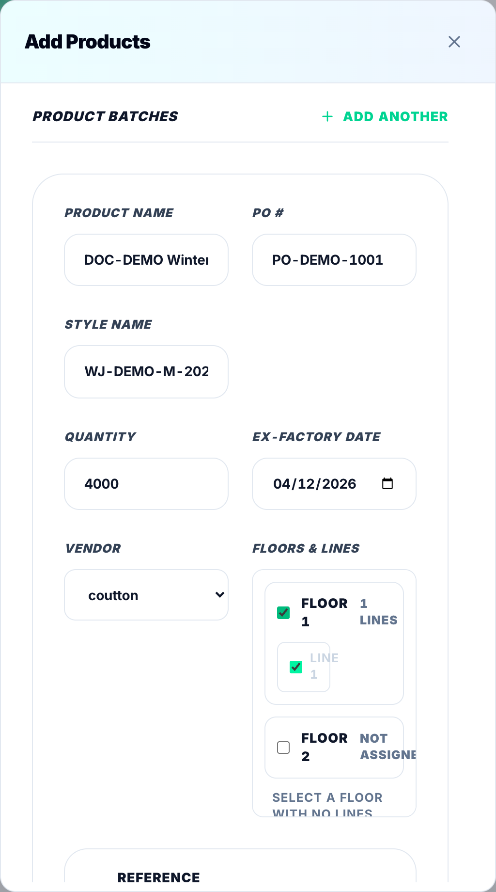

- Tick a **floor** to assign it.
- Then tick individual **lines** under it to use only those lines.
- Tick the floor and **leave every line unticked** to book the **whole floor**.
- Assigned floors and lines are marked *occupied* for capacity tracking.
- Sample orders never use this — they go to the sampling department instead.

### 11.2 Adding more batches

**Add Another** appends a second product block; the bin icon in its corner removes it. All batches
created in one submit share the project, the stage pipeline and the SLA settings below, but keep
their own product, PO, quantity, date, vendor and floors.

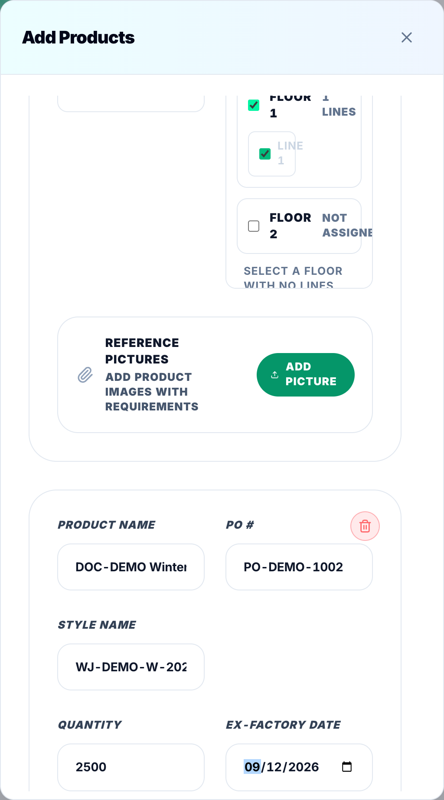

### 11.3 Stage days and SLA chunks

Below the batches is the same **Predicted Stage Days** panel, this time listing the **15 bulk
stages**. The rules are identical: `0` days means the stage is not created, target days accumulate
from the start date, and buffer days are recorded separately without moving dates.

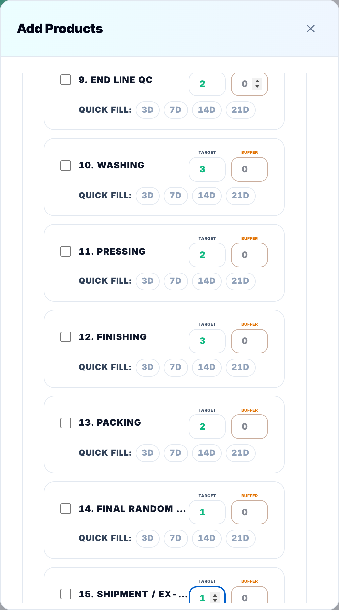

**Merging stages into one SLA chunk.** Use this when the floor treats several steps as one block of
time. Tick two or more stages — a **Merge Selected (n)** button appears:

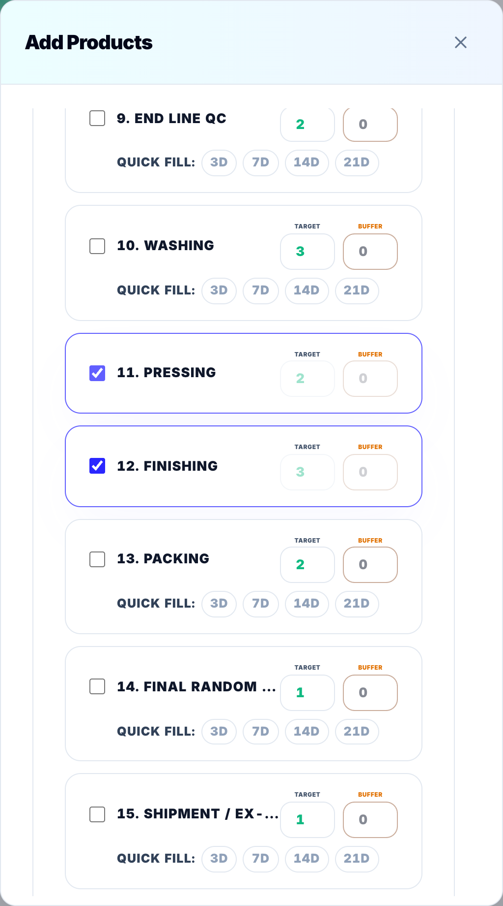

Click it and enter the total target SLA days and buffer days (contingency time) for the whole group:

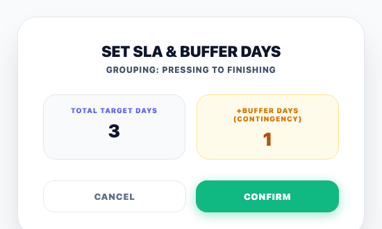

Confirm, and the group becomes a **Merged Chunk**. It is named automatically from its first and last
stage ("Pressing to Finishing"), shows **Total Chunk SLA Days** and **+Buffer Days** (both editable),
lists the stages it contains, and offers **Unmerge**. The merged stages disappear from the individual
list because their timing is now managed by the chunk.

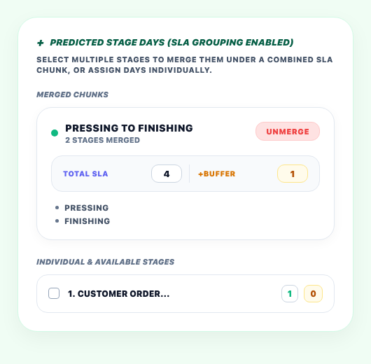

On the order page later, a chunk appears in the timeline as a bordered block labelled e.g. `4D CHUNK`
containing its stages.

> **⚠️ Ex-Factory Date Guard:** The cumulative sum of your bulk stage days (including merged chunks) cannot exceed the earliest Ex-Factory date among the batches. If exceeded, a real-time warning notifies: *"⚠️ You exceed X day(s) to Ex-Factory date!"* and the Launch Track button is locked until stage durations are reduced or the Ex-Factory date is extended.

### 11.4 Submit

Click **Launch Track**. Every batch becomes its own bulk order, each with its own full stage
pipeline:

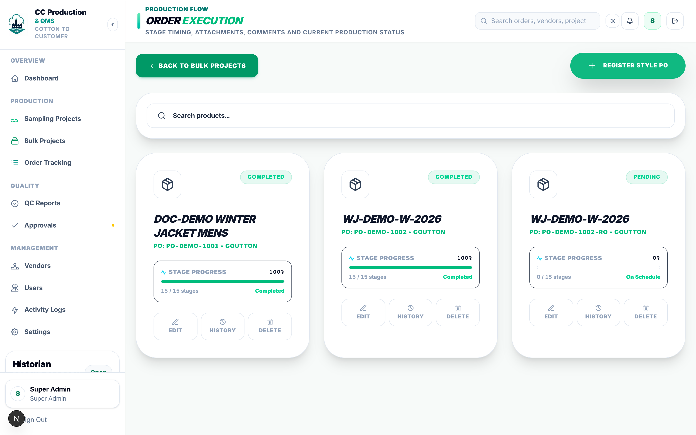

Each card shows the PO, vendor, **Stage Progress** (`0 / 15 stages`), delay state, and the
**Edit / History / Delete** actions.

> **Older orders:** bulk orders created before Style Name was collected have none. The card now falls
> back to the product name so it is never untitled, but add the real style via **Edit** when you see
> one — it is what the order page and reorder both use.

---

## 12. Step 9 — Run the 15 bulk stages

Click a card to open the order.

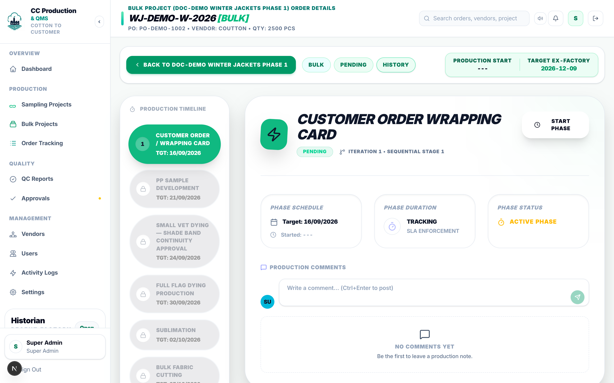

The page is the same as the sampling one, with the 15-stage pipeline in the timeline. Stage 1,
**Customer Order / Wrapping Card**, is open; everything else is padlocked.

Running an ordinary bulk stage is exactly as on the sampling track: **Start Phase** → confirm →
work → **Complete Stage** → confirm.

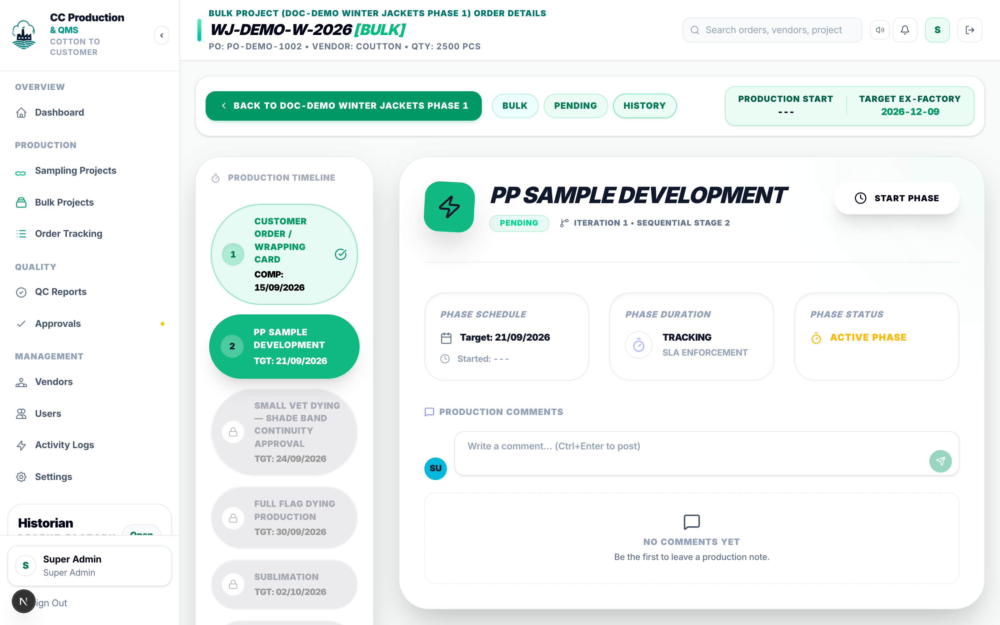

What differs on the bulk track is that **four stages are quality gates**:

| Stage | Buttons you get |
|---|---|
| **PP Sample Development** (stage 2) | Three: Approved / Conditional Approved / Not Approved |
| **Small Vet Dying — Shade Band Continuity Approval** | Two: **Accept** / **Reject** |
| **Full Flag Dying Production** | Two: **Accept** / **Reject** |
| **Final Random Inspection** | Two: **Accept** / **Reject** |
| Every other stage | One: **Complete Stage** |

---

## 13. Step 10 — Conditional approval & defect gating

This is the part of the system people most often get stuck on, so follow it closely.

Start **PP Sample Development**. You get the three-option QC panel:

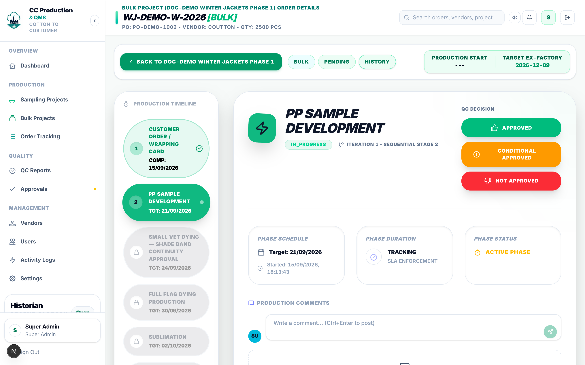

Choose **Conditional Approved** and pick the requirement:

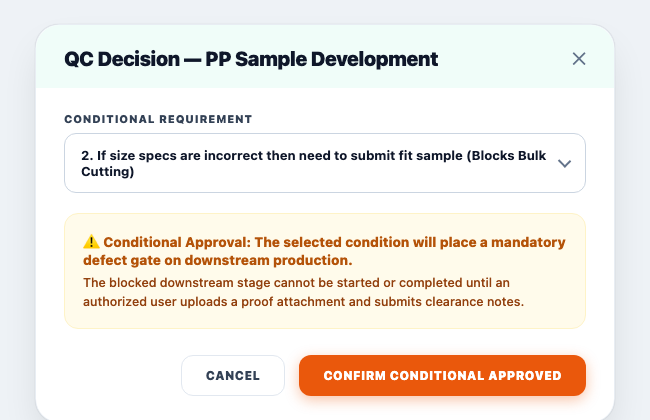

The dialog spells out the consequence: the chosen condition *"will place a mandatory defect gate on
downstream production"*. Confirm it.

The stage completes — but an amber banner is now attached to it:

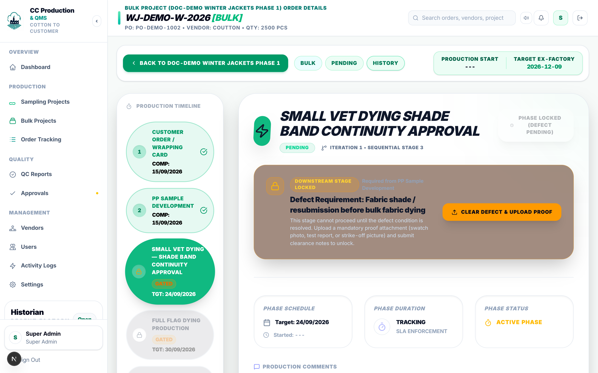

Production continues, **except** for the stages the condition gates. Select the gated stage and you
see this:

Three things to notice:

1. In the timeline, the gated stages carry an amber **GATED** badge and a padlock.
2. The action button is replaced by **Phase Locked (Defect Pending)** — it cannot be started or
   completed, and the API refuses too, so there is no way around it.
3. An amber panel states the exact defect requirement and which stage it came from, with a
   **Clear Defect & Upload Proof** button.

### 13.1 Clearing the defect

Click **Clear Defect & Upload Proof**:

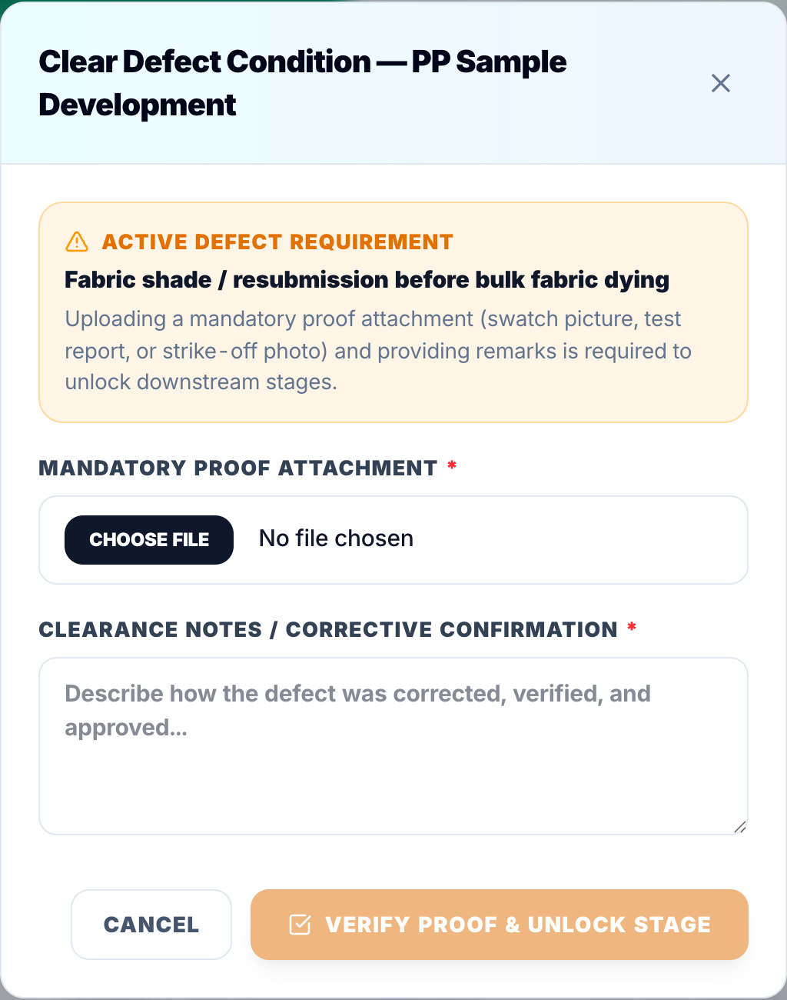

Both inputs are **mandatory** — the system will not accept one without the other:

| Input | Requirement |
|---|---|
| **Mandatory Proof Attachment** | One file: PNG, JPG, WebP or PDF. A swatch photo, lab-dip report or strike-off picture. |
| **Clearance Notes / Corrective Confirmation** | Written confirmation of how the defect was corrected and verified. |

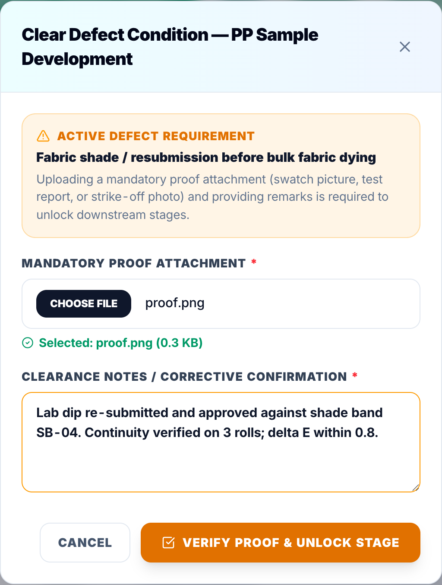

Click **Verify Proof & Unlock Stage**. The gate lifts immediately:

The banner turns green — **Condition Cleared & Unlocked** — recording who cleared it, when, and the
notes, with **View Proof Attachment** to open the evidence. The **GATED** badges are gone and
**Start Phase** is available again. The proof is also filed in the order's attachments as
*[Clearance Proof] <filename>*.

> A condition can only be cleared once, and only if the stage was conditionally approved. Attempting
> it twice returns *"Condition is already cleared."*

### 13.2 Accept / Reject on a dying stage

With the gate cleared, start the dying stage. Because it is an inspection stage, you get
**Accept** and **Reject**:

**Reject** opens the rework dialog:

| Field | Notes |
|---|---|
| **Repeat From Stage** | On bulk this is **locked to the same stage** — a rejected bulk stage repeats itself. The dropdown therefore contains only that one option. |
| **Rejection Reason** | Required. Becomes the CA record. |
| **Correction Plan** | Becomes the PA record. |

**Start Rework Iteration** bumps the iteration counter and resets that stage to pending, exactly as
on the sampling track, and the entry appears in the QC Rejection Log.

---

## 14. Step 11 — Inspection stages, completion & Reorder

**Final Random Inspection** (stage 14) is the last quality gate before shipment:

Accept it, complete **Shipment / Ex-Factory**, and the order flips to **completed** automatically:

A **↻ REORDER** button now appears — the bulk equivalent of *Move to Bulk*. It clones a finished
order into a new one so a repeat buy does not have to be typed from scratch.

### 14.1 Creating a reorder

The form has five numbered sections, all pre-filled from the original order:

1. **Bulk Project Classification** — the original order's project is already selected. Change it, or
   name a new project, if the repeat belongs somewhere else.
2. **Product Specifications** — Product Name, **Style Name**, PO # (suffixed `-RO` automatically),
   Priority, Fabric, Tech Pack #.
3. **Reorder Quantity & Delivery Schedule** — new quantity and a new **Ex-Factory Date** (both required).
4. **Assigned Vendor & Floor Lines** — carried over; change the factory or lines if the repeat runs elsewhere.
5. **Stage Pipeline & SLA Schedule** — the original stage days are pre-loaded; adjust, buffer or merge as needed.

If you clear a required box, the form tells you exactly which one instead of failing quietly:

Click **↻ Create Reorder →**. A new bulk order is created, linked to the original, and opened:

> Only **completed** orders can be reordered — otherwise: *"Only completed orders can be reordered."*

---

## 15. Everyday order actions

Every order card carries the same action row:

### Edit an order

**Edit** changes Product Name, Style Name, PO #, Quantity, Ex-Factory Date, Priority, Assigned Vendor,
reference pictures — and, for Super Admins only, the **Sample Class / Bulk Class** the order belongs
to. Use it to add the missing Style Name on bulk orders.

Editing an order does **not** rebuild the stage schedule. Stage days are set at creation.

### History

**History** shows the complete audit trail of the order — creation, every field change, every stage
start and completion, approvals, rejections, condition clearances and attachments — with who did it
and when. It merges order history and activity-log entries into one time-ordered list.

### Cancel an order

**Delete** does not erase anything. It sets the order to **cancelled** and deactivates it, so it
leaves the working lists while staying fully readable in history. There is no undo button in the UI —
confirm deliberately.

### Assign an order to this class

If you open a class and see an order that belongs to no class (or to a different one), an amber
**Assign** (or blue **Reassign**) button appears on its card. One click permanently links that order
to the class you are currently viewing. This is how orders created outside a class get filed.

### Ex-Factory Date Guard

When assigning days to stages or grouping stages into SLA chunks during order creation:
- **Constraint Rule**: The projected cumulative completion date of the stages **must be equal to or less than** the order's Ex-Factory Date (`projected_completion_date <= ex_factory_date`).
- **Real-Time Warning Notification**: If the assigned days exceed what is allowed before the Ex-Factory date, the system triggers a prominent alert:
  > **⚠️ You exceed X day(s) to Ex-Factory date!** (Total assigned: Y days, Allowed: Z days until YYYY-MM-DD).
- **Submission Guard**: The submit button is locked with `Exceeds Ex-Factory Date by Xd`. If submission is attempted, an error feedback dialog blocks track initialization.
- **Backend API Validation**: The backend validates every stage's calculated target date against `order.ex_factory_date` on creation, additions, and updates, returning HTTP 400 with the exact days exceeded if violated.

---

## 16. Supporting screens

### Order Tracking

One table of every order across both tracks — style, PO, vendor, floor/line, current stage, quality
risk, DHU and delay status. This is the screen for the daily production meeting.

### 16.1 Professional Multi-Sheet Excel (.xlsx) & CSV Export

Both the **Sample Classes** (`/samples`) and **Bulk Projects** (`/bulk-projects`) dashboards feature built-in export capabilities for factory review meetings, merchandiser planning, and buyer reporting:

#### 1. Executive Multi-Sheet Excel Workbook (`.xlsx`)
Clicking **Export Excel (.xlsx)** generates a styled, multi-sheet workbook tailored for corporate management:
- **Sheet 1: Master Overview**: Lists every active class and product across the entire system. Features executive Charcoal Slate headers (`#1E293B`), zebra striping, frozen header rows, and color-coded status badges:
  - **Green (`#DCFCE7`)**: Completed stages and orders.
  - **Blue (`#E0F2FE`)**: In-progress active production stages.
  - **Red (`#FEE2E2`)**: Delayed stages or orders exceeding SLA deadlines.
  - **Amber (`#FEF3C7`)**: Pending upcoming stages.

- **Sheets 2..N: Dedicated Tab Per Class / Project**:
  - Every Class/Project automatically receives its own individual tab at the bottom of the Excel workbook.
  - Includes an executive Class Banner (`#0F766E` Teal for Samples, `#1E3A8A` Navy for Bulk).
  - High-level Metadata Card: Buyer/Customer, Assigned Factory/Vendor, Class Status, Active Styles Count, and Total Production Quantity.
  - Product Stage Pipeline Table: Shows Style Code, PO #, Quantity, Current Active Stage, Status, Target Date, Progress %, Ex-Factory Date, Delivery Status, and Latest Stage Notes.
  - Quick navigation link to jump back to the Master Overview.

#### 2. WIP Product Master Sheet (CSV)
Clicking **Export CSV** downloads a structured Work-In-Progress (WIP) table where every product has its own row:
- Full 17 columns: `Class Serial`, `Class Name`, `Customer`, `Vendor`, `Product Name`, `Style Code`, `Order / PO #`, `Quantity`, `Current Stage`, `Stage Status`, `Stage Target Date`, `Completed Stages`, `Total Stages`, `Progress %`, `Ex-Factory Date`, `Delivery Status`, `Latest Stage Notes`.
- Enables Excel AutoFilter (e.g. filter to show all products in *Stitching* or *QC Check*).
- Enables sorting by *Ex-Factory Date* to see imminent shipment deadlines first.
- Also supports Matrix Grid view (`?view=matrix`) with classes on the horizontal X-axis.

Accessible to Super Admin, Admin, and Manager roles.

### Approvals

The queue of items waiting on a decision, so approvals are not missed by being buried inside
individual orders.

### Activity Logs

Company-wide audit trail: logins, class and order creation, stage updates, approvals, rejections,
clearances. Visible to Super Admin, Admin, Manager and Viewer.

### Vendors

Where factories, their **floors**, **lines** and **sampling departments** are maintained. If a floor
or line is missing from an order form, add it here first. A vendor must be **active** to be usable,
and Managers only see vendors assigned to them.

---

## 17. Error messages explained

| Message | What it means | What to do |
|---|---|---|
| *Invalid email or password.* | Login failed. | Re-type; if it persists use Forgot password (needs admin approval). |
| *Add predicted days for at least one sample/bulk stage.* | Every stage was left at 0 days. | Enter target days for the stages you need. |
| *Stage 'X' target date exceeds the order's Ex-Factory date… You exceed X day(s) to ex-factory date.* | Total stage SLA days exceed the available days before shipment. | Adjust stage days or chunks to equal or be less than the Ex-Factory date. |
| *Missing Required Field — Please fill in X…* | A required box on the Move to Bulk or Reorder form is empty. The dialog names the field. | Scroll to the named field and complete it. |
| *Selected vendor is not active or does not exist.* | The vendor was deactivated. | Pick another vendor, or have an admin reactivate it. |
| *Cannot update this stage. Previous stage (X) must be COMPLETED first.* | Stages run in sequence. | Complete stage X first. |
| *Stage 'X' is LOCKED by pending conditional defect from Y…* | A conditional approval is gating this stage. | Clear the defect with proof — [§13.1](#131-clearing-the-defect). |
| *Rejection is only permitted on designated inspection/approval stages.* | You tried to reject a normal production stage. | Only the gate stages can reject. Use comments to record the issue, and reject at the next gate. |
| *This bulk stage can only repeat from itself.* | On bulk, rework repeats the same stage. | Accept the single option in the dropdown. |
| *Sample rejection can only be raised from QC Check.* | Sampling rejections belong to PPS QC Check. | Carry on and reject at QC Check. |
| *Rejection reason is required.* | The reason box was blank. | Write the defect (it becomes the CA record). |
| *Mandatory proof attachment file must be uploaded…* / *Clearance notes/remarks are required.* | A defect clearance needs **both** a file and notes. | Attach the proof and write the confirmation. |
| *Only PDF and image files are allowed.* | Wrong file type on an attachment. | Use PDF, JPG, PNG or WebP. Reference *pictures* accept images only. |
| *Only completed sample orders can be promoted to bulk.* | Move to Bulk needs a finished sample. | Complete all sample stages first. |
| *Only completed orders can be reordered.* | Reorder needs a finished order. | Complete it, or create a fresh PO instead. |
| *You can only access orders for your assigned vendors.* / *…your assigned bulk projects.* | Role scoping. | Ask an admin to assign that vendor to you. |
| *Condition is already cleared.* | The defect was cleared by someone else. | Refresh the page. |

---

## 18. Quick reference

### Sampling stages (10)

`Sample Start` → `Fabrication` → `Fabric Cutting` → `Printing / Embroidery / Embellishment` →
`Stitching` → `Washing` → `Finishing` → **`PPS QC Check`** → `Dispatch` → `Sample Completed`

### Bulk stages (15)

`Customer Order / Wrapping Card` → **`PP Sample Development`** →
**`Small Vet Dying — Shade Band Continuity Approval`** → **`Full Flag Dying Production`** →
`Sublimation` → `Bulk Fabric Cutting` → `Printing / Embroidery / Embellishment` → `Stitching` →
`End Line QC` → `Washing` → `Pressing` → `Finishing` → `Packing` →
**`Final Random Inspection`** → `Shipment / Ex-Factory`

(Bold stages are quality gates with approve/reject decisions.)

### Statuses

| Order status | Meaning |
|---|---|
| `pending` | Created, no stage started. |
| `in_progress` | At least one stage under way. |
| `completed` | Every stage completed — set automatically. |
| `delayed` | Ex-factory date passed while unfinished. |
| `cancelled` | Cancelled via Delete; read-only in history. |

| Stage status | Meaning |
|---|---|
| `pending` | Not started (or reset by a rework iteration). |
| `in_progress` | Started; start time recorded. |
| `completed` | Finished; completion time recorded. |

| Approval status | Meaning |
|---|---|
| `approved` | Gate passed. |
| `conditional_approved` | Passed with a condition; may gate a downstream stage until proof is filed. |
| `not_approved` | Rejected; a new iteration was started. |

### Day-to-day rules worth memorising

1. Vendor → Class/Project → Order → Stages. Always create in that order.
2. A stage with **0 target days is never created**.
3. **Target days build the schedule; buffer days do not.**
4. Stages are strictly sequential — no skipping.
5. Only gate stages can reject; sampling can restart anywhere, bulk repeats itself.
6. A conditional approval **stops downstream work** until proof is uploaded.
7. `completed` is set by the system, never by hand.
8. Delete means **cancel**, not erase.
9. Give every bulk order a real **Style Name** — it titles the order and carries into reorders.
10. Write the CA and PA properly — they are the permanent audit record.
